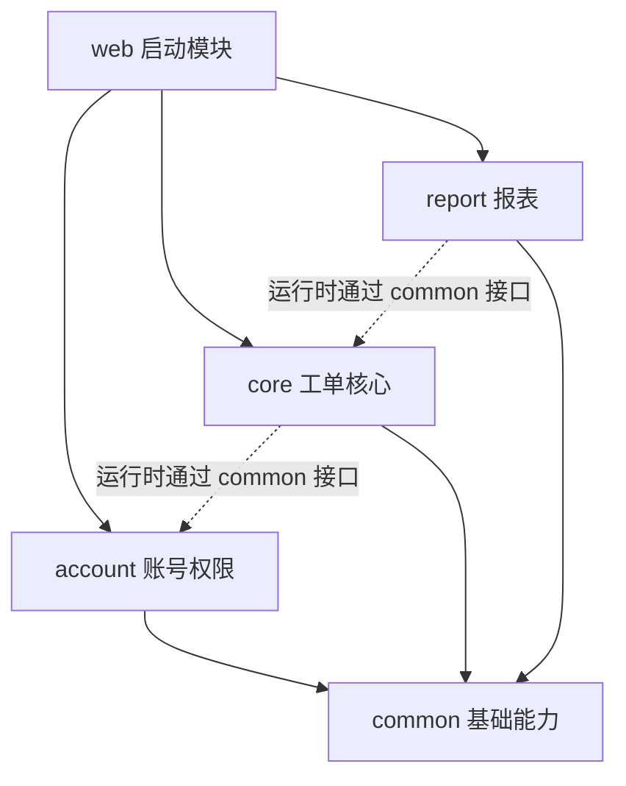

# 技术栈与模块划分

> 所属：[总体设计](00-总体设计.md) · 原文章节：§2 + §3

## 2. 技术栈

| 技术 | 版本 | 用途 |
|---|---|---|
| Java | 21 | 语言 |
| Spring Boot | 4.0.x | 基础框架（如遇兼容问题可降 3.5.x） |
| Maven | 3.9+ | 多模块构建 |
| MySQL | 8.0+ | 业务库 |
| Redis | 7.x | 会话、缓存、分布式锁、序列号 |
| MyBatis-Flex | 1.11.x | ORM、分页、租户插件、审计 |
| Sa-Token | 1.45.x | 登录、权限、会话 |
| Redisson | 3.x（建议较新版本） | 分布式锁、限流 |
| RocketMQ | 5.x / 4.9.x | 异步消息 |
| XXL-Job | 2.4+ / 3.x | 定时任务 |
| Caffeine | 3.x | 本地缓存 |
| MapStruct | 1.5.x | DTO/VO 转换（按需，暂未引入） |
| Lombok | 1.18.x | 简化代码 |
| Hutool | 5.8.x | 工具库 |
| FastJSON2 | 2.0.x | JSON（按需，暂未引入） |
| EasyExcel / Fesod | 3.x / 2.x | Excel |
| springdoc | 3.0.3 | API 文档（Swagger UI，M1 已接入） |
| MinIO | 最新稳定版 | 对象存储（替代阿里云 OSS） |
| Docker Compose | 2.x | 本地中间件 |

> 说明：原项目用阿里云 OSS、短信、OCR、e签宝等第三方服务。学习项目统一抽象成接口，开发环境用 MinIO、Mock 短信、Mock OCR，避免真实依赖和费用。

## 3. 模块划分

### 3.1 模块结构

```text
fixguild/
├── pom.xml
├── common/          # 基础能力：响应、异常、租户、鉴权拦截、MQ、锁、Excel、加密
├── account/         # 租户、用户、角色、菜单、登录、权限
├── core/            # 工单、派工、客户、设备、技师、附件
├── report/          # 统计、导出、消息（二期也可先并入 core）
└── web/             # 启动模块 + 跨模块配置 + 聚合 Controller
```

一期为了降低复杂度，可以先做 4 个模块：`common`、`account`、`core`、`web`。`report` 等 `core` 稳定后再拆。

### 3.2 依赖关系



原则：

- `common` 不依赖任何业务模块；
- 业务模块之间尽量不直接依赖；
- 跨模块调用通过 `common` 里的 `I*ProviderService` 接口，或 Spring 事件；
- `web` 只做启动和跨模块配置，不写核心业务逻辑。

### 3.3 包结构示例

```text
com.fixguild
├── common
│   ├── annotation        # @Log、@DistributedLock、@IgnoreTenant、@EncryptedField
│   ├── aop               # 锁、日志、租户忽略、脱敏审计
│   ├── config            # MyBatis-Flex、Sa-Token、Redisson、Jackson、springdoc
│   ├── domain            # BaseEntity、TenantEntity、CommonResponse、PageParam
│   ├── enums             # 状态、错误码、业务类型
│   ├── exception         # BusinessException、GlobalExceptionHandler
│   ├── filter            # TraceIdFilter、AuthInterceptor
│   ├── mq                # RocketMQProducer、AbstractRocketMQConsumer、MqPayload
│   ├── service           # I*ProviderService 跨模块接口
│   └── utils             # 加密、脱敏、Excel、日期、金额
├── account
│   ├── controller
│   ├── entity
│   ├── mapper
│   ├── param
│   ├── vo
│   ├── service
│   └── provider
├── core
│   ├── controller
│   ├── entity
│   ├── mapper
│   ├── param
│   ├── vo
│   ├── service
│   ├── statemachine      # 工单状态机
│   ├── event             # 领域事件
│   └── provider
└── web
    ├── WebApplication.java
    ├── config
    └── controller        # 跨模块/公共接口
```

---

上一篇：[01-目标与范围](01-目标与范围.md) · [返回总览](00-总体设计.md) · 下一篇：[03-领域模型](03-领域模型.md)
