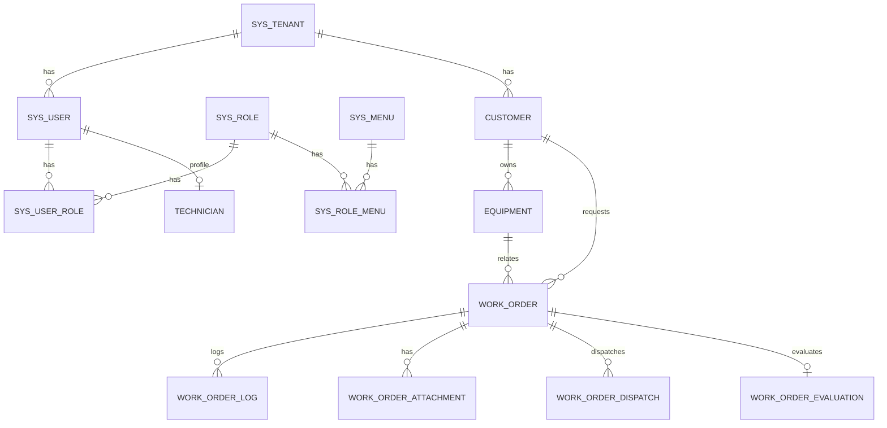

# 4. 领域模型

> 所属：[总体设计](00-总体设计.md) · 原文章节：§4

## 4.1 核心实体

| 实体 | 说明 |
|---|---|
| Tenant | 租户企业 |
| User | 登录账号（平台/租户/技师） |
| Role / Menu | RBAC |
| Technician | 技师档案 |
| Customer | 客户档案 |
| Equipment | 设备档案 |
| WorkOrder | 工单 |
| WorkOrderLog | 工单操作日志/时间线 |
| WorkOrderAttachment | 工单附件 |
| WorkOrderDispatch | 派工记录 |
| WorkOrderEvaluation | 评价（二期） |

## 4.2 ER 图

## 4.3 租户模型

- `sys_tenant.tenant_code` 是业务租户号，例如 `T0001`；
- 所有业务表的 `tenant_id` 存的就是 `tenant_code`；
- 平台数据的 `tenant_id = '0'`；
- 平台管理员可以跨租户查询，但必须显式使用 `@IgnoreTenant`，并记录审计日志；
- 租户用户只能看到自己 `tenant_id` 的数据；
- 技师只能看到 `technician_id = 自己` 的工单。

---

上一篇：[02-技术栈与模块划分](02-技术栈与模块划分.md) · [返回总览](00-总体设计.md) · 下一篇：[04-工单状态机](04-工单状态机.md)
