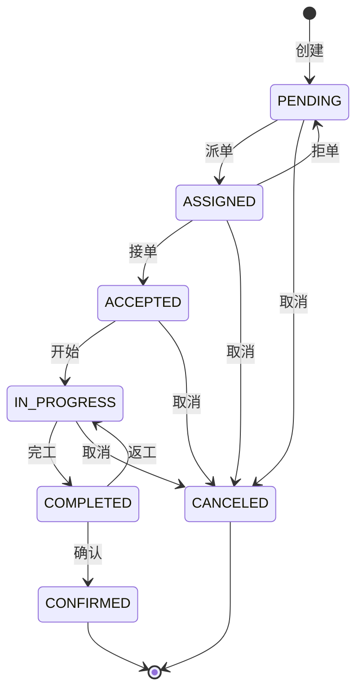

# 5. 工单状态机

> 所属：[总体设计](00-总体设计.md) · 原文章节：§5

## 5.1 状态定义

| 状态 | 含义 | 终态 |
|---|---|---|
| `PENDING` | 待派单 | 否 |
| `ASSIGNED` | 已派单，待技师接单 | 否 |
| `ACCEPTED` | 技师已接单 | 否 |
| `IN_PROGRESS` | 处理中 | 否 |
| `COMPLETED` | 已完工，待确认 | 否 |
| `CONFIRMED` | 已确认，完成 | 是 |
| `CANCELED` | 已取消 | 是 |

## 5.2 状态流转表

| From | To | Action | 操作人 | 守卫条件 |
|---|---|---|---|---|
| `PENDING` | `ASSIGNED` | `ASSIGN` | 租户管理员/调度员 | 技师存在且可用 |
| `PENDING` | `CANCELED` | `CANCEL` | 租户管理员/调度员 | 填写原因 |
| `ASSIGNED` | `ACCEPTED` | `ACCEPT` | 被派技师 | 工单属于自己 |
| `ASSIGNED` | `PENDING` | `REJECT` | 被派技师 | 填写拒单原因 |
| `ASSIGNED` | `CANCELED` | `CANCEL` | 租户管理员 | 填写原因 |
| `ACCEPTED` | `IN_PROGRESS` | `START` | 被派技师 | 工单属于自己 |
| `ACCEPTED` | `CANCELED` | `CANCEL` | 租户管理员 | 填写原因 |
| `IN_PROGRESS` | `COMPLETED` | `COMPLETE` | 被派技师 | 填写完工说明，至少 1 张照片 |
| `IN_PROGRESS` | `CANCELED` | `CANCEL` | 租户管理员 | 填写原因 |
| `COMPLETED` | `CONFIRMED` | `CONFIRM` | 租户管理员/调度员/客户 | 无 |
| `COMPLETED` | `IN_PROGRESS` | `REOPEN` | 租户管理员 | 填写返工原因 |
| `CONFIRMED` | — | — | — | 终态 |
| `CANCELED` | — | — | — | 终态 |



## 5.3 状态机实现

不引入工作流引擎，手写一个显式状态机：

```java
public enum WorkOrderStatus {

    PENDING, ASSIGNED, ACCEPTED, IN_PROGRESS, COMPLETED, CONFIRMED, CANCELED;

    private static final Map<WorkOrderStatus, Set<WorkOrderStatus>> TRANSITIONS = Map.of(
            PENDING,     Set.of(ASSIGNED, CANCELED),
            ASSIGNED,    Set.of(ACCEPTED, PENDING, CANCELED),
            ACCEPTED,    Set.of(IN_PROGRESS, CANCELED),
            IN_PROGRESS, Set.of(COMPLETED, CANCELED),
            COMPLETED,   Set.of(CONFIRMED, IN_PROGRESS),
            CONFIRMED,   Set.of(),
            CANCELED,    Set.of()
    );

    public boolean canTransitionTo(WorkOrderStatus target) {
        return TRANSITIONS.getOrDefault(this, Set.of()).contains(target);
    }

    public void checkTransition(WorkOrderStatus target) {
        if (!canTransitionTo(target)) {
            throw new BusinessException(ErrorCode.INVALID_STATUS_TRANSITION,
                    "工单状态不允许从 " + this + " 变更为 " + target);
        }
    }
}
```

命令服务统一走：

```java
@Transactional
public void transition(Long orderId, WorkOrderStatus target, WorkOrderAction action, String remark) {
    WorkOrder order = workOrderMapper.selectOneById(orderId);
    // 1. 租户校验（插件已做，这里再防御一次）
    // 2. 状态校验
    order.getStatus().checkTransition(target);
    // 3. 乐观锁更新
    int rows = workOrderMapper.updateByCondition(
            WorkOrder.builder().status(target).build(),
            WorkOrderTableDef.WORK_ORDER.ID.eq(orderId)
                    .and(WorkOrderTableDef.WORK_ORDER.VERSION.eq(order.getVersion()))
                    .and(WorkOrderTableDef.WORK_ORDER.STATUS.eq(order.getStatus().name()))
    );
    if (rows == 0) {
        throw new BusinessException(ErrorCode.CONCURRENT_MODIFICATION);
    }
    // 4. 写日志
    // 5. 事务提交后发事件
}
```

---

上一篇：[03-领域模型](03-领域模型.md) · [返回总览](00-总体设计.md) · 下一篇：[05-数据库设计](05-数据库设计.md)
