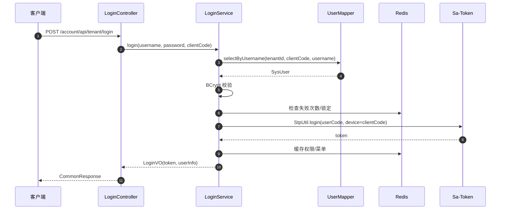
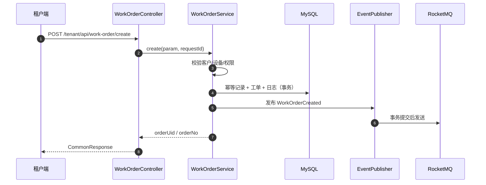
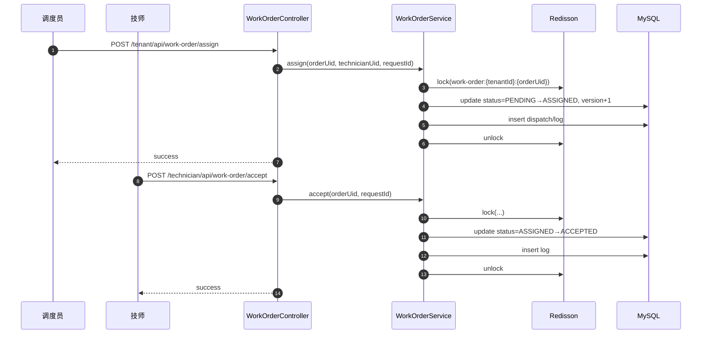
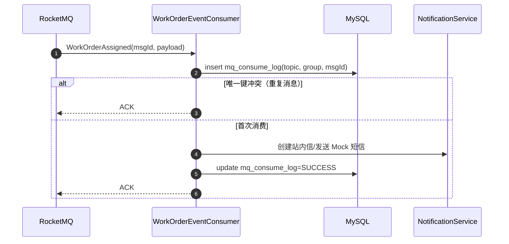
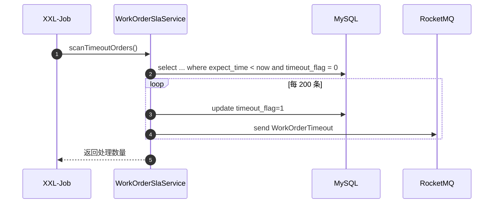
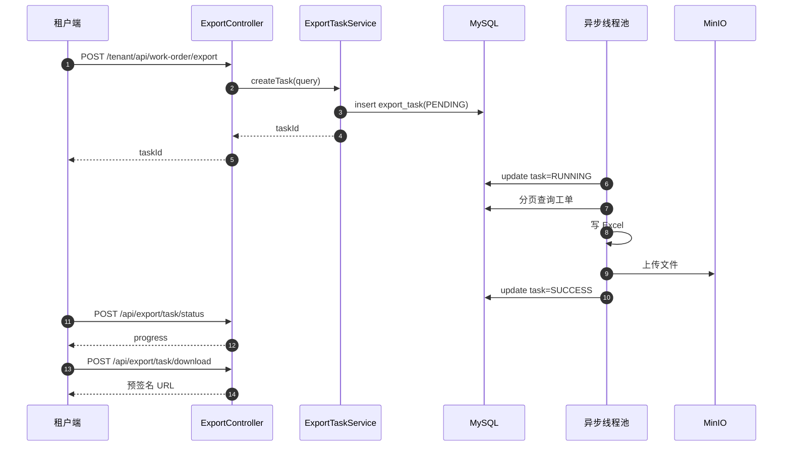

# 8. 关键时序

> 所属：[总体设计](00-总体设计.md) · 原文章节：§8

## 8.1 登录

## 8.2 创建工单

## 8.3 派单 / 接单

## 8.4 MQ 消费

## 8.5 超时任务

## 8.6 异步导出

---

上一篇：[06-API设计](06-API设计.md) · [返回总览](00-总体设计.md) · 下一篇：[08-多租户与权限](08-多租户与权限.md)
